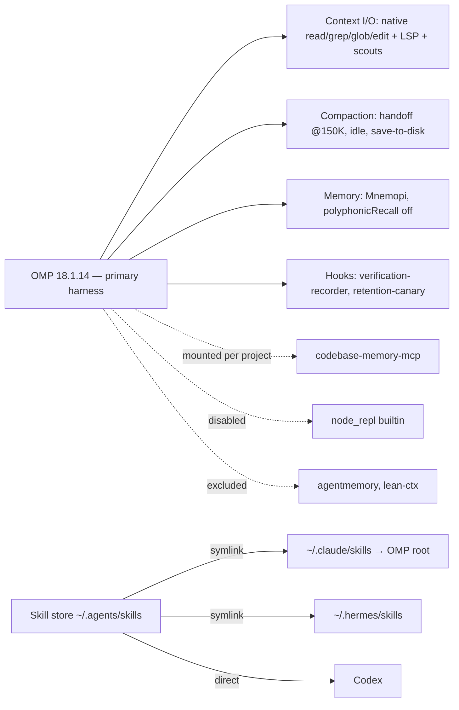

# Agent Stack — Decisions

> This is the only operative decisions doc. On 2026-08-19 it absorbed `AGENT_STACK.md` and `TOOLS_RESEARCH.md`, which were deleted. The frozen evidence ledger `AI_CONTEXT_TOOLING_COMPARISON.md` was deleted the same day; its git history keeps the full evidence, grades, and methods. Binding ADRs: `docs/adr/0006`–`0010`. Review standards: `agentic_env/vendored/mattpocock/skills/code-review/STANDARDS.md`, bundled with `/code-review`.
>
> Layout (2026-09-02): the summary table, then the measured rules every layer cites, then one section per layer in the order **Decided → Why → Rejected → Revisit → Wiring**, so each decision traces from evidence to config line. "Live wiring" holds the cross-cutting contract and "Upstream watch" the pre-registered triggers. Vocabulary: `CONTEXT.md`.

## The stack

| Layer | Decided | Why | Alternatives | Revisit when |
|---|---|---|---|---|
| Harness | OMP | Best model + LSP + edit anchors | Hermes, Claude Code, opencode, Codex | Never unless OMP fails |
| Context I/O | OMP native only | Cache-stable, anchor-safe; compressors break edits | lean-ctx (removed, ADR-0009), Headroom, rtk | Native tools visibly fail |
| Compaction | handoff @ 150K, idle on, save-to-disk | −43–50% tokens, quality held | 120K threshold | End-green < 88% → revert |
| Memory | Mnemopi + retention-canary hook | Recall good, keyless, zero infra; canary covers silent-loss defect | Hindsight (sole challenger), mem0, agentmemory, Letta, Zep | Cross-project memory sharing needed → Hindsight |
| Code graph | codebase-memory-mcp installed, not registered on OMP | Costs quality, 10× tokens; litmus fired 0× | GitNexus, GraphRAG, Serena, etc. | A project's litmus fires weekly |
| Skills | Fit-curated roster (see Skills section): Pocock core + Ponytail forced + Caveman on demand + 13 pstack skills vendored + local `review-loop` | Fit-judged per recipe job; usage is diagnostic only | Full Pocock 27 + pstack 52 stores | A recipe step has no fitting skill; an Excluded trigger fires |
| Hooks | verification-recorder, retention-canary | Pass-rate read-outs; silent-memory-loss tripwire | cadence-governor (rejected 08-19), external monitoring | Recorder DB unread by next read-out; canary false-warns |

OMP is the primary harness, Hermes a supported agent, and Claude Code and Codex installed agents; see [Agent tiers](#agent-tiers-2026-09-02).

## Rules (measured; violations cost real money)

1. Judge by success-adjusted billed cost, never token reduction (correlation r=0.15).
2. Cache reads are ≈ 68.6% of the bill. A tool that can't touch cached re-reads can't move it.
3. No lossy compressor on the read→edit path. It corrupts edit anchors: patch success fell from 27/40 to 15/40.
4. One semantic-memory owner per agent. OMP LSP owns live symbol truth.
5. Wiring routes tools; prose doesn't. A prompt mandate repeated 3× got 15.6% adherence, and cadence-governor nudges got 16.4%, about chance.
6. Vendor claims measure at 1/8–1/3 of what is advertised, or negative. Adopt only on locally measured, pre-registered endpoints.
7. Decisions live in committed docs; memory is convenience.
8. The user adopts skills on workflow fit. Usage audits are diagnostic: they flag stale or duplicate skills for re-review and never gate adoption. Rule 6 governs tools only. `CONTEXT.md` defines the usage units: user-invoked ≠ model-invoked ≠ string-scan.

Every rejection below names the pre-registered threshold it missed: lean-ctx 1 semantic call < 5; agentmemory 0 calls in 934 sessions; node_repl 0 calls; cadence-governor 16.4% adherence ≈ chance. The stack doctor enforces exactly what those verdicts left standing. The round 2 full-market sweep (17 tools, 08-11) adopted nothing, because no candidate ships third-party agent-on-repo evidence.

## Decisions by layer

### 1. Harness — OMP

- **Decided:** OMP, floor `18.1.14` (`stack_metadata.OMP_VERSION`). Contract settings were reviewed at `v18.1.14`. Installation follows GitHub's latest stable release redirect, streams the platform binary to a temporary file while hashing it, checks that release's `SHA256SUMS.txt`, verifies the downloaded executable's version floor and atomically replaces the installed binary. Success also requires `omp` on `PATH` to meet the floor; another executable is never removed to fix PATH ordering. The checksum proves download integrity, not an independent publisher signature.
- **Why:** best model access, LSP, and edit anchors. The alternatives lost on tooling, not on model.
- **Rejected as primary:** Hermes, Claude Code, opencode, Codex. A paired OMP/Hermes benchmark is [parked](#parked).
- **Revisit:** never unless OMP fails. OMP major bump → re-verify the converge keys at the new tag, raise the floor, and re-run the docker smoke. Through 18.1.14 the keys sat in `packages/coding-agent/src/config/settings-schema.ts`; at 18.18.8 that file is gone and each domain registers its own under `packages/coding-agent/src/` (`extensibility/settings.ts` for `skills.*`, `session/context-settings.ts` for `compaction.*`, `mnemopi/settings.ts`, `memory-backend/settings.ts`). All contract keys still exist there with unchanged defaults.
- **Wiring:** contract keys verified at the pinned tag: `memory.backend`, `compaction.{thresholdTokens,idleEnabled,handoffSaveToDisk,methodOrder}`, `skills.{enableClaudeUser,enableAgentsUser}`, `extensions`. The drift check is block-scoped (`OMP_AGENT_CONFIG_CONTRACT`), not a substring match. The `node_repl` built-in is disabled on both OMP roots (0 calls; `OMP_GATED_BUILTINS`, doctor-enforced). MCP servers and the skill roster bind at instance start, so after any `mcp.json` edit run `/mcp reload` or restart live omp instances.
- **Desktop clients (2026-11-01):** T3 Code and PyCharm use native `omp acp`. `agentic-configure-acp` renders the [packaged JSON](agentic_env/acp/) and copies it or adds missing client registrations. Existing conflicts remain unchanged. [Setup](guides/omp-acp.md). Registration is opt-in, outside bootstrap/doctor requirements. ACP clients supply the MCP list instead of OMP's on-disk discovery. Client permission modes answer requests OMP emits. They do not sandbox OMP or require approval for every edit.
- **Desktop installation:** `agentic-install-agents --client t3code --client pycharm` uses Homebrew on macOS, preserves existing installations, and does not configure ACP. Desktop picker rows are unchecked; `--all`/noninteractive bootstrap retain their CLI-only scope. Other hosts use manual application installation. These applications remain outside stack updater/doctor requirements.
- **Opt-in same-user isolation (2026-11-10, #12):** `agentic-omp-isolated` snapshots standalone OMP and checksum-pinned nono 0.81.0 into a separate trusted instance; dedicated project/runtime grants, explicit environment/HTTPS allowlists, Linux network/IPC/UTS isolation, pathname-socket and canonical-command mediation, no runtime elevation or fallback. Bootstrap, updater, normal OMP and personal state stay unchanged. Direct dedicated Codex device OAuth was explicitly accepted: its tokens remain visible to sandbox tools, rather than adding broker infrastructure. Real CachyOS enforcement, fresh OAuth, streamed inference and project tools passed; this is not a permanent rollout or general toolchain acceptance. [Deployment, grants, recovery, evidence and limits](guides/omp-isolation.md).

#### Agent tiers (2026-09-02)

- **Primary harness — OMP.** Installer-enforced, smoke-verified, doctor failure.
- **Supported agent — Hermes.** Its CLI, skills, MCP config, and health checks are managed; the doctor only warns (`TODO secondary`). It keeps its `codebase-memory-mcp` and `agentmemory` entries (behaviour unmeasured).
- **Installed agent — Claude Code, Codex.** Latest CLI at or above the reviewed floor, plus curated skills from the skill store. No MCP config is written or diagnosed; the doctor warns when the binary is missing or below its floor. Claude floor `2.1.308` (2026-10-26, latest stable), raised alone so Claude Code reads the project `AGENTS.md` that the [pstack workflow](guides/poteto-workflow.md#4-point-every-agent-at-the-verifier) relies on.

#### Secondary agents TODO (closed 2026-09-02)

1. Hermes install correctness: **closed by `chore/agentic-env-bump-pins`**. Reviewed release v2026.8.31 (`0.21.0`, `29112bef`). `_install_hermes` converges fresh or outdated checkouts to `HERMES_COMMIT` and leaves a checkout at or above the floor alone; the installer refuses rollbacks without `--force-commit`.
2. `agentmemory` + `codebase-memory-mcp` wiring on Claude/Codex: **not pursued**. Claude Code and Codex are installed agents, and the measured need for managed wiring is zero (agentmemory 0 calls in 934 sessions, codebase-memory litmus 0×). Hermes keeps its entries; the `@agentmemory/mcp` shim is pinned to `AGENTMEMORY_VERSION`.
3. Codex per-tool approval filters: **not pursued**. There is no managed Codex MCP config to filter.
4. Claude/Codex pin refresh: **closed by `chore/agentic-env-bump-pins`**. Codex 0.152.1, Claude 2.1.258, agentmemory 0.9.29; installer script checksums re-verified unchanged.

### 2. Context I/O — OMP native only

- **Decided:** OMP-native `read`/`grep`/`glob`/`edit` + LSP + scout subagents. Nothing sits on the read→edit path.
- **Why:** Rules 2 and 3. Native tools are cache-stable and anchor-safe.
- **Rejected:**
  - lean-ctx: failed its own pre-registered threshold (1 semantic call < 5; ADR-0008 fallback). Removed stack-wide 2026-09-02 after containment failed twice (ADR-0009). `stack_metadata.py` keeps a reinstall pointer to ≥ 3.10.0, never 3.9.x, whose read-path default is lossy.
  - Headroom (+48.4% cost), rtk (wash), LLMLingua (degrades on code agents): rejected on third-party evidence.
  - Context Mode, mcp-compressor, OmniRoute, pxpipe: duplicate native tools, unproven, or unneeded. aider repomap and Repomix were not pursued.
- **Revisit:** grep+LSP+scouts visibly fail on a real task → context I/O re-shop (Parked). Semantic search visibly missing → reinstall lean-ctx ≥ 3.10.0 with an OMP-native gated entry (ADR-0009), never the claude-import path.
- **Wiring:** no config OMP loads may contain read-interception prose, including `~/.claude.json` `mcpServers.*.instructions`; the doctor greps for `ctx_` / `shadow mode` / `auto-route`. `lean-ctx` is purged **and** disabled on both OMP roots (`OMP_EXCLUDED_SERVERS`). It must be absent from `~/.claude.json` (mandatory), and a stale Hermes entry warns.

### 3. Compaction — handoff @ 150K, idle on, save-to-disk

- **Decided:** `handoff` at 150K tokens, idle compaction on, handoff saved to disk.
- **Why:** −43–50% tokens with quality held.
- **Rejected:** 120K threshold (same quality, less headroom). The `handoff-as-deliberate-habit` skill: compaction already handles fragmentation mechanically, while "remember to invoke at seams" is prose, and prose doesn't route (Rule 5).
- **Revisit:** end-green < 88% → revert.
- **Wiring:** `compaction.{thresholdTokens,idleEnabled,handoffSaveToDisk,methodOrder}` in `~/.omp/agent/config.yml` (backup `config.yml.bak-tuning`).

### 4. Memory — Mnemopi + retention canary (settled 2026-08-19)

- **Decided:** Mnemopi stays the default (user, 2026-08-11); the retention-canary hook covers its one defect.
- **Why:** recall is good, keyless, and needs zero infra. Stage 1 (08-11): zero-LLM Hindsight won the registered endpoint (decision-recall 1/4 @1,024 tok vs 0/4; cross-project isolation 4/4 PASS). Forensics (08-12) showed Mnemopi's 0/4 was a **silent retention gap**, not a recall failure, despite correct wiring. A Stage 1b replay on the populated bank reached ≈ parity (1 PASS + 3 PARTIAL; reflect works keyless). The gap differential (08-17) fixed the edges (retention worked through 07-14, was dead 07-19→08-10, and resumed 08-11) and ruled out version, cadence, config, drift, and hooks. The residual defects are opposite. Mnemopi silently loses retention, so the **retention canary was wired 08-18**; Hindsight's defect is recall budget (config). Full data: `docs/memory-backend-research.md`.
- **Rejected:**
  - agentmemory on OMP: 0 calls in 934 sessions, and ADR-0006 requires a single memory owner. It stays on Hermes.
  - Hindsight: the sole challenger. Cross-project sharing is the one thing Mnemopi structurally cannot do.
  - mem0, MemPalace, Letta, Zep: unproven claims, wrong lane, or paid-only.
  - Stage 2 bake-off: skipped (user, 2026-08-19). It was blocked on an OpenAI-compatible key, and Stage 1b parity plus the canary cover the residual risk. The research doc keeps the unblock paths if this reopens.
- **Revisit:** related-project memory sharing becomes a live need → Hindsight (vs mem0 bake-off). Upstream https://github.com/can1357/oh-my-pi/issues/8940 ships → retire the canary. That issue, filed 2026-08-19, reports the silent retention gap and differential and asks for retain-attempt telemetry.
- **Wiring:** `memory.backend: mnemopi`; `mnemopi.polyphonicRecall: false`. The key lives under `mnemopi.`, not `memory.` (same in 17.0.5); the template, host config, and drift check were fixed 2026-09-02. `agentmemory` is purged and disabled on both OMP roots and absent from `~/.claude.json`. Hermes: `mcp_servers.agentmemory` (`npx -y @agentmemory/mcp@<AGENTMEMORY_VERSION>`) + `memory.provider: agentmemory`.

### 5. Code graph — codebase-memory-mcp, installed but not registered on OMP

- **Decided (2026-11-16):** the binary stays installed and Hermes stays wired, but neither OMP root registers the server. A project that needs the graph mounts it in its own `.omp/mcp.json`.
- **Why:** it costs quality and 10× tokens on ordinary tasks, and the litmus never fired while the server was registered and disabled. The last call in any transcript is dated 2026-08-03. None of the 1,068 Mac transcripts modified since 2026-08-05 contains a call, and none of the 206 on the Linux host does. This is the removal that was pre-registered for 2026-10-01.
- **Litmus:** the task needs >10 native calls, crosses repo boundaries, or aggregates the whole graph. If it fires about weekly in one project, mount the server in that project and run a `fast` reindex before the first query.
- **Per-project mount:** add `{"mcpServers": {"code-graph": {"command": "codebase-memory-mcp"}}}` to the project's `.omp/mcp.json`. Use a name other than `codebase-memory-mcp`: the user-level `disabledServers` list hides that name from every source, a project file included. On OMP 18.21.0 the same-named project entry stayed hidden and `code-graph` mounted its 14 tools.
- **Rejected:** GitNexus, GraphRAG, cognee, Graphiti, Semantica, Serena: no coding evidence, license problems, or paid-only.
- **Revisit:** a project mounts it → re-measure answer quality there. Upstream 0.11.0 available vs floor 0.9.0; bump only then.
- **Wiring:** no `mcpServers` entry on `~/.omp/agent/mcp.json` or `~/.pi/agent/mcp.json`, and no OMP descriptor. `disabledServers: [agentmemory, node_repl, codebase-memory-mcp, lean-ctx]` stays, because OMP also imports `~/.claude.json` and `~/.codex/config.toml`, where the server may still be defined (`OMP_EXCLUDED_SERVERS`). The configurator removes a leftover entry, and the doctor fails until it has. Hermes is wired (unmeasured).

### 6. Skills

**38 curated skills:** 19 Matt, 14 in the pstack pack (13 pstack skills and the local `review-loop`), three ponytail, two caveman. [The manifest](agentic_env/skill-packs.json) owns the roster and sources; [Matt](agentic_env/vendored/mattpocock/UPSTREAM.md) and [pstack](agentic_env/vendored/pstack/UPSTREAM.md) record provenance and adaptations. [Verification and research history](docs/skills-workflow-recheck-2026-09-21.md). Update of 2026-10-13: Matt `49dd158`, pstack `1dcc2ba` (0.15.21); added `retro`, `pr`, `benchmark-checklist`, `correct`; dropped `resolving-merge-conflicts` after upstream removed it. Update of 2026-10-26: dropped `ponytail-gain` and `ponytail-help`; they only report on or explain ponytail itself, serve no workflow job, and were listed to the agent in every session. Update of 2026-11-11: Matt `4ae2317` (sub-agents start with a fresh context window), pstack `c742dd6` (0.15.36), ponytail v5.3.3, caveman v4.1.0. Added pstack `in-your-own-words` and `sharpen`. Restored `resolving-merge-conflicts`, maintained locally: conflicts recur and the roster had no method. Dropped `ponytail-review`: v5 widened it into a general change review that duplicates `code-review`. Caveman is Apache-2.0 since v3.0.0; only its skills are installed, never its proxy or CLI (Rules 2 and 3). Caveman v4 moved its `ultra` and `wenyan` levels into the separate `ultracave` and `megacave` skills and dropped `lite`; neither skill is selected (no recorded use), so `/caveman ultra` and `/caveman wenyan` have no target here. Vendored instructions were reviewed against OMP 18.18: past sessions go through `archive` and `seance`, and `scout` is read-only only by its checked tool grant.

**Update of 2026-11-16:** pstack `bf0c7cd` (0.15.42); upstream cut `how` and `why` to short briefs without reference files. Four skills left the roster, each because something else covers its job. `interrogate` gave way to `review-loop`, a local skill adapted from [Tstack](https://github.com/t3dotgg/tstack)'s `sol-loop` and `council`: one other model or a panel reviews in rounds until a stated gate passes. In the October–November transcripts `interrogate`'s reviewers ran in no Mac session, while one session built the same loop by hand and spent five rounds grading mobile screens before the user said there was no mobile version; `review-loop` therefore opens with a brief that states what is out of scope. `reflect` turned a detour into skill edits; `retro` reports those candidates and `writing-for-agents` governs the edit. `in-your-own-words` became one line of the agent rules below. Matt `handoff` duplicated OMP's handoff compaction (layer 3). `technical-writing` became model-invocable for document deliverables: `/unslop` was typed in 15 prompts across 8 November sessions and `technical-writing` loaded in none of them. `tdd`'s description now requires a test-first request by name, after it loaded in 45 October–November sessions that had none.

**Selection (2026-10-25):** every curated skill is opt-in, as with `npx skills add`. The `default` profile is what a non-interactive install selects, not a host requirement. The installed set is the selection: `agentic-stack-doctor` requires no curated skill (the built-in ponytail descriptor stays mandatory), and `agentic-skill-drift` checks only installed curated skills unless `--skill-profile <name>` requires a whole profile. Tradeoff: a skill deleted by hand reads as deselected. A persisted selection file was rejected: `skills remove` or `rm` would leave it stale, and the skills CLI lock records only remote global installs, not the vendored Matt/pstack packs.

**Opt-in first-party pack:** `agentic-env` ships `apache-spark-static` for code/initial-plan review with known, estimated, or unknown input volume, and `apache-spark-runtime` for live or completed cluster executions (split 2026-10-15). Both are model-invoked on distinct evidence triggers, belong to no profile, and can be used independently. Install either or both with the [Apache Spark route](README.md#apache-spark-optimize-existing-jobs). The original process ablation and scoped harness evidence are retained in [research and review](docs/apache-spark-optimization-research.md); they do not establish real Spark performance.

**Installation scope:** managed installations use the native skills CLI and agent skill roots. Custom-directory installation copies complete selected packages into one explicit folder; it selects no agent targets and registers no global provenance. The Python-only route copies the vendored subset offline and reports remote-only exclusions. It is the Windows copy path, not Windows stack provisioning. Both standalone routes refuse existing skill names, leave unrelated destination files intact, and leave package bodies unchanged. The [installation runbooks](README.md#choose-an-installation-path) own commands, prerequisites, and maintenance.

**Source drift:** `agentic-skill-drift` performs deterministic, on-demand checks without an agent. It compares each curated package with its reviewed fingerprint, its canonical managed installation, and the pinned/latest upstream packages. `--no-installed` checks repository sources without host-install noise. `Local/upstream` reports our deviations separately; `--diff` exposes pinned → latest and latest → local changes across whole packages. Vendored adaptations alone never count as drift; matching vendored content takes precedence over stale lock origins, while remote installations retain origin checks. Exit 1 means drift (or invalid manifest/pack); exit 2 means a requested comparison is incomplete or CLI usage is invalid. Commit pins resolve default-branch HEAD through Git; tag pins use GitHub's release/tag API. No skill code is executed and no update is automatically applied. Packs still move only by reviewed tags or vendored updates, preserving required adaptations. Re-record the baseline with `--update-baseline` as part of that review, never to silence a finding; scoped updates preserve all unselected pack entries and refuse an unreadable existing baseline. [Commands and report semantics](README.md#source-drift).

**Routing, not a pipeline.** Small known changes stay direct: implement and exercise the affected path. Core methods apply only to their named job; escalation needs the stated trigger. See the [practical routing guide](guides/skill-routing.md) and [pstack workflow](guides/poteto-workflow.md).

| Job | Core | Escalation → work product |
|---|---|---|
| Requirements and interfaces | `grilling`, `grill-with-docs`, `domain-modeling`, `codebase-design` | External facts → `research`; uncertain interaction → `prototype`; multi-session decisions → `wayfinder` |
| Implementation and bugs | Matt `tdd` when test-first is requested; `diagnosing-bugs` for failures | Lifecycle/shared-state/downstream risk → `blast-radius` executed safety proof; a measured perf number to report or act on → `benchmark-checklist` |
| Review | `code-review`: Standards + Spec | A stated gate, or doubt left after one review → `review-loop`: rounds with one other model or a panel |
| Understanding | `how`: current mechanism | Historical intent → `why`; mechanism and rationale explained together → pstack `teach`; unclear explanation → `wait-what` |
| Style | Force-injected ponytail bundle | Requested terse output → caveman; prose cleanup → `unslop`, never globally injected |

Other escalations: `to-spec`/`to-tickets` for durable plans; `pr` for a PR body (drafting only); `improve-codebase-architecture` for report-only surveys; `show-me-your-work` for run audits. `sharpen` deepens a shallow prompt and returns the rewrite. `resolving-merge-conflicts` handles a merge or rebase stopped on conflicts and concludes it only on request. Retrospectives split two ways: `retro` reports environment candidates (navigation, checks, standards, tool economy); `correct` turns a mistake class seen twice into an enforced guard. `recall` is for scoped transcripts, not the memory bank. Agent documents use `writing-for-agents`; substantial human-facing material uses `technical-writing`. `wizard` requires approved stages and destinations and human execution, and never inspects secret files.

**Invocation:** the pstack pack is manual-only except `technical-writing`, which also loads when a document is the deliverable. Also manual are Matt's `grill-with-docs`, `improve-codebase-architecture`, `retro`, `to-spec`, `to-tickets`, `wait-what`, `wayfinder`, `wizard`. Other Matt methods, including `pr`, keep narrow automatic triggers. Explicitly invoked recipes may load named dependencies; Claude Code loads a manual dependency only when the user's message names it. Role labels grant no invocation or action authority.

**Agent rules (2026-11-16):** [`agentic_env/rules/AGENTS.md`](agentic_env/rules/AGENTS.md) is a generic rules file that `agentic-install-skills-mcps --agent-rules` writes to `~/.agents/AGENTS.md`. It is optional: the guided install asks with yes as the default, a `--yes` run needs the flag, and neither bootstrap nor the doctor requires it. It holds the instructions the user kept repeating, and it names the skill for recurring moments instead of widening vendored descriptions: `code-review` before a merge-readiness answer, a second review after a review fix, `diagnosing-bugs` on a repeated error. The October–November transcripts are the evidence. Readiness was answered without reading the diff in three sessions, and in two of them a later `code-review` found real defects. Eleven sessions fixed review findings without reviewing the fix. One session made three failed fixes and never loaded `diagnosing-bugs`. One garbled dictation ended in an MR, a force-push and auto-merge. This is prose, and Rule 5 measured prose at 15.6% adherence for tool routing. It is accepted here because these moments have no wiring point: no hook sees a merge-readiness question. Limits: OMP keeps one user-level context file, so a user's own `~/.omp/agent/AGENTS.md` hides this one unless it imports it; task subagents receive no `AGENTS.md`; Hermes is not covered; Claude Code and Codex read only the user's own files ([README](README.md#agent-rules)); and OMP's built-in prompt tells the agent to pick the standard option and proceed, which pulls against the rule to offer options and wait. `tdd` is the one description edited instead, because a rule cannot narrow a trigger that fires too often. Revisit at the next transcript read-out: recount those four kinds of episode. If they have not dropped, delete the file and widen the `code-review` and `diagnosing-bugs` descriptions instead.

**Managed runtime:** `~/.agents/skills` is canonical; Claude and Hermes link to it. OMP loads the Claude root (`enableClaudeUser: true`, `enableAgentsUser: false`). It hides manual skills from its automatic listing but still loads them by name. Installed Hermes ignores the manual flag and warns on those symlink targets, then loads them successfully, so the body guards are behavioral, not enforced hiding. Do not weaken trust to suppress the warnings. Standalone copies create none of these links and do not enroll another harness in managed discovery, health checks, or updates.

**Review:** freeze explicit refs or scoped WIP into a snapshot. The snapshot includes intended committed, staged, unstaged, and untracked changes, captured through a temporary Git index and object database without altering the user's staging. Both reviewers read that snapshot. Verify its hashes before and after, and keep prompts and results outside it. Hashes are not a sandbox. Restricted grants or tool-less input enforce read-only review. A multi-model claim requires two distinct provider/model identities that each returned successfully; report substitutions and failures. Standards (2026-09-23): the six shared lenses ship inside `/code-review` as `STANDARDS.md` and apply in every repo. A repo's own `CODING_STANDARDS.md` holds only repo-specific rules or waivers and overrides a lens rule by rule. The lenses apply at review time only; they are not injected into global instruction files, and no skill copies them into repositories.

**Review rounds:** `review-loop` takes a fresh snapshot each round and sends it to reviewers that run without tools, skills, rules or context files. A single reviewer needs one model that answered; a panel needs two distinct ones.

**Verification:** reuse existing drivers. Create `.agents/skills/verify-<app>` only when needed, and prove one mapped feature with it. Explicit maintenance exercises every mapped feature, edits only the verifier, and reports product regressions. Ordinary changes check the affected paths. OMP discovers project skills; Hermes requires explicit project trust.

**Exclusions:** `implement` and `implement-spec` add an unwanted orchestrator and unconditional commits/merges. `bro` duplicates the chosen `wait-what`; `ketchup` depends on it. `poteto-help` routes to the excluded `poteto-mode`/`setup-pstack`. `principle-explain-the-number` is a subset of `benchmark-checklist`. Public `tdd` remains Matt's and does not fold in pstack's contract. Public `teach` uses pstack's engineering explanation through `how`/`why`; Matt's sustained learning workspace is no longer selected or vendored. Reopen `architect`/`arena` only for expensive competing designs with a design-only stop. Reopen `swarm` only when a coverage method is needed; native fan-out is not equivalent. Beta skills (`chief-of-staff`, schedulers) require maturity and a specific job. Principles belong in standards, not another installed pack. Duplicate style and interview methods stay excluded. Every other unlisted skill needs a deliberate adoption decision. Local `graphify` remains outside the packs. Domain docs keep the `CONTEXT.md`/`CONTEXT-MAP.md` names: every local repo uses them, so the vendored Matt skills do not take upstream's `GLOSSARY.md` rename.

Branch creation, commits, pushes, PRs, tracker writes, infrastructure changes, and credential changes each need their own authorization. Revisit the roster when a named job lacks a method. [The prior contract](https://github.com/MihaiA24/.dotfiles/blob/0a827c85d89e3737cca03f20eb5a17c3c1b117fe/agentic-env/DECISIONS_AI_TOOLING.md) keeps the complete historical rationales.

### 7. Hooks — verification-recorder + retention-canary

- **Decided:** two hooks, `omp/hooks/verification-recorder.ts` and `omp/hooks/retention-canary.ts`.
- **Why:** pass-rate read-outs (OMP 527 verifications @ 87.3% pass; dedicated event tables beat string scans) and a silent-memory-loss tripwire (layer 4).
- **Rejected:**
  - cadence-governor (2026-08-19, measured non-adherence). Across 589 session logs, the verification nudge got 16.4% adherence within 10 calls, declining by fire number (17.5% → 10.6% → 8.7%). That is at or below the ~22% chance that any 10-call window contains a verification command. The overwrite steer got a 15% immediate switch (n=20). The 08-11 read-out's sole positive signal (first fire: 59% verified within 25 calls) came with 60% of all fired nudges being spam beyond N=75; the 3-strike cap treated the symptom. Prose doesn't route (Rule 5). Reopen bar: a mechanism that routes (blocks or redirects) rather than nudges.
  - External monitoring: no mechanism inside the harness.
- **Revisit:** recorder DB unread by the next read-out; canary false-warns; canary fire-rate on 18.1.x read at the next read-out (zero fires and #8940 still open = keep); #8940 ships → retire the canary.
- **Observation (2026-09-09) → resolved 2026-09-15 (#43):** the canary reported an empty or never-retained bank while `recall` returned memories from it. Cause: `episodic_memory.created_at` is ISO `T…Z`, while `working_memory`/`facts` use `YYYY-MM-DD HH:MM:SS`. The lexical SQL `max()` over the union picked the ISO row, the parser appended a second `Z`, `Date.parse` returned `NaN`, and `null` read as "never". The canary therefore fired in every project with one episodic memory and two sessions. Fix: `max(julianday(created_at))`, which parses both formats and orders them numerically, with a regression test in `retention-canary.test.ts`. This closes the "canary false-warns" Revisit trigger, which had fired. The 07-19→08-10 gap the canary guards remains real.
- **Wiring:** each hook is registered exactly once in `extensions:` with its file present (doctor-enforced). Hook files are diagnosed, never written (machine-provisioning boundary). The installer finds them via `$AGENTIC_ENV_ROOT`, then the cwd/package ancestors, so bootstrap runs from the agentic-env checkout. It refuses to seed `config.yml` without them, because a half-seeded config becomes three doctor failures later.

## Live wiring (this machine)

The mandatory contract is the OMP layer. It is installer-enforced (`agentic-configure-agent-mcps`), smoke-verified (`docker-smoke-test.sh`), and diagnosed by `agentic-stack-doctor`. The doctor is read-only and exits 1 only on an OMP check; Hermes wiring and the Hermes/Claude/Codex binaries warn with a TODO tag. It runs as the last phase of `agentic-bootstrap` and `agentic-update-stack`.

- Clean-host contract (2026-09-02; version floors 2026-09-16): `uv tool install --force . && agentic-bootstrap` run from an agentic-env checkout yields exactly this stack. Reviewed versions are **floors**, not pins (`STACK_VERSION_FLOORS`). Installers fetch the latest release and verify it is at or above the floor, so a host ahead of the review is compliant and a host below it is a doctor failure. MCP, hook and installed-skill drift is never tolerated; which curated skills are installed is the user's choice ([§6 Selection](#6-skills)). Two components are still fetched at a fixed identity. Hermes installs release `29112bef` (`HERMES_COMMIT`) through an installer script fetched from commit `95d42656` (`HERMES_INSTALL_COMMIT`, #39). The installer refuses to roll a checkout backwards, so a host at or above the floor is left alone. The codebase-memory-mcp release archives are pinned by per-arch SHA256. Remote scripts stay hash-pinned regardless. The npm references install `@latest` and carry a written contract reason (`remote_install_contract`).
- Fresh-machine reproducibility: `agentic-configure-agent-mcps` seeds `~/.omp/agent/config.yml` from `OMP_AGENT_CONFIG_CONTRACT` when absent and verifies it when present (`converge_omp_agent_config`). The seed and drift checker share the contract; existing user YAML is never rewritten.
- Configuration ownership (2026-09-10; tightened 2026-09-30): existing MCP definitions are notify-only. Missing entries are added. Mismatched commands or arguments, Hermes memory-provider conflicts and OMP settings drift return failure for manual correction; affected user settings are not repaired. Atomic writes preserve configuration symlinks, updating the resolved target with a backup beside it; dangling links are refused. The explicit OMP exclusion and default-gating policy is unchanged, and it grants no general repair authority.
- Hermes severity split (2026-09-13): `agentic-configure-agent-mcps` hard-fails on Hermes drift, because it refuses an unsafe write to a user-owned file. `agentic-stack-doctor` only warns for Hermes, because it diagnoses a secondary agent and its exit code reflects the OMP contract.
- Acceptance scope (2026-09-10): native Apple Silicon macOS and Arch Linux x86_64, plus the existing Debian container. Intel macOS is out of scope; direct CachyOS verification is deferred. An Arch run is Arch-family proxy evidence, not a verified CachyOS run. The README records successful runs and exact OS/architecture coverage.
- Windows scope (2026-09-22): native CI verifies only the dependency-free vendored-skill copier. It does not extend clean-host provisioning acceptance, validate the native skills CLI on Windows, or prove that copied skill workflows work on Windows. The README records the separate [copy acceptance evidence](README.md#ci-and-recorded-evidence). Since 2026-10-25 that job runs only on manual dispatch.
- Acceptance safety (2026-09-30): checks-only never updates stack components. Acceptance requests `clean-acceptance.sh --update` explicitly in the isolated acceptance HOME, then reruns checks. Both mandatory hook suites run before acceptance; smoke checks the `default` profile's source/install fingerprints (opt-in packs excluded) without comparing latest upstream. Debian/macOS acceptance use Node 24 LTS.
- Local gate (2026-10-25): the GitHub workflow runs only on manual dispatch. `local-ci.sh` runs on Linux or macOS against the committed HEAD: unit, Debian and Arch checks, plus native macOS on Apple Silicon. It writes `local-ci.attestation`, a tree hash that excludes the attestation itself, and records the legs that passed; a pull request merges only when `./local-ci.sh --verify` passes on its rebased head. Run it once per finished branch, not per commit; a pull-request check only warns when the head is unattested. Tradeoff: the record is self-attested (enough for a single maintainer, not tamper-proof); Windows copier coverage, and macOS coverage when the gate ran on Linux, depend on dispatching the workflow. Rejected: a `develop` branch (one maintainer, PR-gated), keeping hosted runs per push (the macOS job bills ten times the Linux rate) and a blocking pre-commit gate (too slow per commit).
- Local gate cache (2026-11-02): share artifact stores across checkouts/PRs under `${XDG_CACHE_HOME:-$HOME/.cache}/agentic-env/local-ci`, override with `AGENTIC_CI_CACHE_ROOT`; separate Debian amd64, Arch amd64 and macOS arm64. Use uv's package/build cache and managed-Python archive cache, npm's `_cacache` only, and URL/checksum-keyed direct release downloads with per-artifact locking and atomic verified publication. HOME/config, interpreters, installed tools, venvs, prefixes and `_npx` stay fresh. Keep older versions; no branch keys or automatic pruning. Resolve floating versions/Claude's hash-pinned floating script normally. Compose resources are run-unique, never pre-deleted by another gate. Upstream nested curl/Git/browser/native-Claude downloads still bypass these caches; native package caches need not deduplicate concurrent network misses. A warm installation is not cold-network evidence. [Controls, coverage and observed path timings](README.md#host-wide-artifact-cache).
- The concrete settings are the **Wiring** line of each layer above: harness (pin, contract keys, `node_repl`), context I/O (excluded servers, prose ban), compaction (`compaction.*`), memory (`memory.backend`, `mnemopi.polyphonicRecall`), code graph (`mcp.json` exclusion), skills (`skill-packs.json`, `skills.enableClaudeUser`, `skills.enableAgentsUser`), hooks (`extensions`).

## Upstream watch

These are pre-registered triggers. Nothing here is acted on until its trigger fires. Layer triggers repeat that layer's **Revisit** line; the installer, skill-pack, screening, and version-review entries appear only here.

- oh-my-pi #8940 (retain-attempt telemetry) ships → retire the retention canary.
- OMP major bump → re-verify converge keys against the per-domain settings files at the new tag (see [Harness](#1-harness--omp) Revisit), raise the floor, re-run the docker smoke.
- Hermes installer (2026-09-15, #39): fetched at commit `95d42656` of `NousResearch/hermes-agent` (the bytes reviewed 2026-09-02). It is never fetched from the floating `hermes-agent.nousresearch.com/install.sh`, which drifted 2026-09-13 and turned every acceptance job red. The two Hermes constants move independently. A version review moves `HERMES_COMMIT` to the new release. `HERMES_INSTALL_COMMIT` moves only when that release needs a newer installer or the reviewed script breaks; re-verify the SHA256 when it moves. At the next Hermes version review, consider fetching `install.sh` from `HERMES_COMMIT` and deleting `HERMES_INSTALL_COMMIT`, so one commit identifies both. `claude.ai/install.sh` remains floating and hash-pinned; on its first drift, apply the same treatment if the vendor publishes a versioned URL.
- OMP installer (resolved 2026-09-23): `omp.sh/install` calls the unauthenticated GitHub REST API both with and without `--ref`; shared CI runner IPs can exhaust its rate limit. The installer now bypasses that script, resolves `github.com/can1357/oh-my-pi/releases/latest`, and verifies the platform asset against the resolved release's `SHA256SUMS.txt` before replacement. Download or integrity failure leaves an existing executable untouched; there is no older-release fallback. Clean acceptance keeps credentials isolated and exercises forced updates on macOS as well as Linux. Local Apple Silicon installation and forced update of `18.2.11` succeeded; clean-host matrix results remain separate CI evidence.
- Canary fire-rate on 18.1.x → read at the next read-out; zero fires and #8940 still open = keep.
- A project mounts `codebase-memory-mcp` → re-measure answer quality there. Upstream 0.11.0 available vs floor 0.9.0; bump only then (the archives are checksum-pinned, so this one does not float).
- Local repos migrate their `CONTEXT.md` files to upstream Matt's `GLOSSARY.md` name → drop the vendored `CONTEXT.md` adaptation (Matt `UPSTREAM.md`) in the same change, so no repo is left with skills that miss its glossary.
- Matt/pstack update → review the source, complete the assets, and reapply adaptations, following each pack's `UPSTREAM.md`. A new tag alone does not replace the native invocation, scope, and authority contracts.
- Tstack `sol-loop` or `council` changes upstream (reviewed at [`t3dotgg/tstack@11e37a7`](https://github.com/t3dotgg/tstack/tree/11e37a74d0a6868c121cd0910ab2b3bd9873b92a), 2026-11-11) → review by hand. `review-loop` is a local skill, so drift compares it with no upstream.
- lean-ctx need fires (semantic search visibly missing on a real task) → reinstall ≥ 3.10.0 per ADR-0009.
- Cross-project memory becomes a live need → Hindsight vs mem0 bake-off.
- Trendshift screening: **Retired** as a routine (0 adoptions across two sweeps); on-demand reruns only.
- Unused manual skills (2026-10-26): OMP transcripts from 2026-06-03 to 2026-10-25 (1,299 sessions) show no `skill://` load and no user invocation of `blast-radius`, `interrogate`, `show-me-your-work`, `reflect`, `benchmark-checklist` or `correct`. Recount on **2027-01-26**. Usage stays diagnostic (see [The stack](#the-stack)): re-judge each skill still at zero against its job, and drop it when another selected skill or the project verifier covers that job. `interrogate` and `reflect` were re-judged early and dropped on 2026-11-16 ([§6](#6-skills)); the recount covers the other four.
- Version review → set every entry in `STACK_VERSION_FLOORS` to the latest stable release at the time of review, then re-run the acceptance matrix. When a workflow needs a newer release of one component, raise only that floor the same way and record why in this file. Floors move on review, never on a single host's install.

## Parked

- Paired OMP/Hermes benchmark — only if OMP-primary ever needs to be definitive.
- Context I/O re-shop — only when grep+LSP+scouts visibly fail on a real task.
